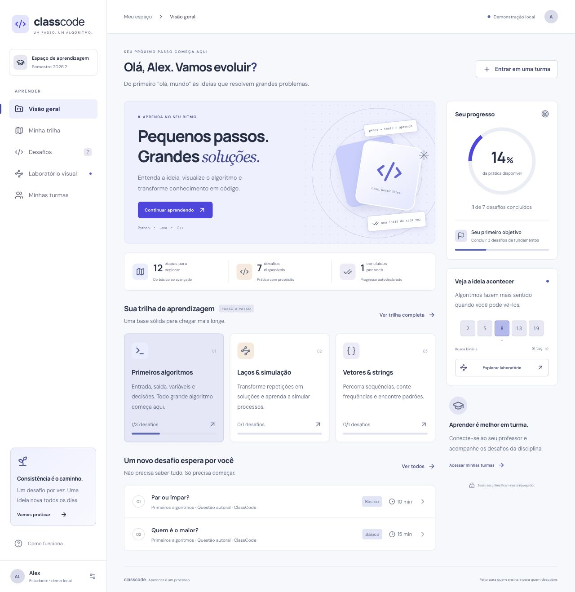

# ClassCode

**Um passo. Um algoritmo.** Plataforma educativa para aprender algoritmos com trilhas progressivas, dicas no tempo certo e acompanhamento por professores.

[Demonstração](https://marcuscspereira.github.io/ClassCode/) · [Plano de desenvolvimento](docs/PLANO.md) · [Entrega 2](docs/ENTREGA-2.md) · [Registro de passagem](docs/PASSAGEM.md) · [Arquitetura](docs/ARQUITETURA.md) · [Design](docs/DESIGN.md) · [Pesquisa](docs/PESQUISA.md)



## O que esta entrega contém

Base React + TypeScript + Vite, com design responsivo e fluxos navegáveis. Sem configuração, abre no modo de demonstração local. O modo remoto conecta Supabase Auth e as RPCs persistentes; ele exige um projeto de desenvolvimento com as migrations aplicadas e ainda precisa de homologação com JWT/PostgREST reais antes de uso institucional.

| Funcionalidade                                    | Estado nesta base                                                                                                                                                                                                                                    |
| ------------------------------------------------- | ---------------------------------------------------------------------------------------------------------------------------------------------------------------------------------------------------------------------------------------------------- |
| Dashboard, desafios, turmas e painel do professor | Interface funcional com dados locais                                                                                                                                                                                                                 |
| Acompanhamento do professor                       | Métricas por aluno e por questão, sinais de atenção, mapa aluno × questão e CSV ([catálogo](docs/ENTREGA-2.md#6-métricas-do-professor-catálogo-v1)); na demo, há uma turma de dados fictícios, identificada como tal, para ver o painel com 8 alunos |
| Revisão do professor                              | O professor lê a evidência de cada aluno, marca a conclusão como revisada ou pede ajuste com comentário, e o aluno vê o retorno na tela do desafio; evidência nova zera a revisão                                                                    |
| Trilha do básico ao avançado                      | 12 etapas mapeadas; 7 desafios nas 5 primeiras                                                                                                                                                                                                       |
| Evolução automática                               | Próximo passo recomendado com motivo e estado de cada etapa conforme conclusões e dicas usadas ([regras](docs/ENTREGA-2.md#5-evolução-automática-e-gradual-modelo-v1)); dados locais por enquanto                                                    |
| Criar turma e entrar com código                   | Funciona no mesmo navegador; experimente `CLASS26`. O professor pode gerar um novo código, e o anterior deixa de valer                                                                                                                               |
| Professor criar questão no padrão pedagógico      | Rascunho com casos de teste ocultos, validação com solução de referência no judge, publicar, editar, arquivar e restaurar (demo e remoto)                                                                                                            |
| Dicas em 3, 7 e 12 minutos                        | Cronômetro local persistido; não é um controle de acesso real                                                                                                                                                                                        |
| Python 3, Java e C++17                            | Editor CodeMirror com realce de sintaxe, indentação, linhas e rascunhos por linguagem                                                                                                                                                                |
| Modo claro/escuro                                 | Botão no topo e preferência salva; primeira abertura em modo escuro                                                                                                                                                                                  |
| Visualizações                                     | Busca binária e bubble sort com passos, reprodução e pseudocódigo                                                                                                                                                                                    |
| Avaliação de código                               | Botão **Executar código** com Judge0 e casos de teste guardados no servidor ([JUDGE-API.md](docs/JUDGE-API.md)); no site estático publicado fica desabilitado. Links para CSES; conclusão autodeclarada com reflexão                                 |
| Login e autorização reais                         | Conectados no modo remoto: cadastro de aluno, login/logout, recuperação e sessão persistida; professor é provisionado por operador com `supabase/scripts/promote-teacher.sql`                                                                        |
| Backend institucional                             | Contrato remoto completo por RPC, RLS, métricas e trilha-base idempotente; validado em PostgreSQL 16 com Auth emulado                                                                                                                                |
| Judge integrado                                   | `npm run dev` usa o endpoint local; o modo remoto usa a Edge Function `judge-submit`, que confere sessão e matrícula. O resultado ainda não é salvo (fatia 2 da [Entrega 4](docs/ENTREGA-4.md))                                                      |

As questões autorais são conteúdo do projeto. Problemas externos são referenciados e abertos no judge de origem; a aplicação não espelha um catálogo de terceiros.

## Rodar em desenvolvimento

Node.js **24 LTS recomendado** (mínimo 22.12) e npm.

```bash
git clone https://github.com/MarcusCSPereira/ClassCode.git
cd ClassCode
npm ci
npm run dev
```

Abra o endereço mostrado pelo Vite, normalmente `http://127.0.0.1:5173`. A demonstração usa `localStorage`; turmas criadas em outro navegador ou dispositivo não aparecem aqui. Uma única identidade e um único conjunto de dados são compartilhados entre as perspectivas locais.

### Rodar com Supabase

1. Aplique, em ordem, `supabase/migrations/*.sql` e depois `supabase/seed.sql` em um projeto Supabase de desenvolvimento novo.
2. Copie `.env.example` para `.env.local`, defina `VITE_DATA_MODE=remote`, a URL e a chave publicável do projeto.
3. Crie contas pela tela de cadastro. Contas nascem como estudante; promova professores somente pelo procedimento de operador descrito em [ARQUITETURA.md](docs/ARQUITETURA.md#provisionamento-de-professor).
4. Para o botão **Executar código**, publique a função do judge (`supabase functions deploy judge-submit`) e configure os segredos do Judge0; passo a passo em [JUDGE-API.md](docs/JUDGE-API.md).

Nunca coloque `service_role` em variáveis `VITE_*`. Para voltar à demonstração, use explicitamente `VITE_DATA_MODE=demo`.

## Experimentar os fluxos

1. Clique em **Começar minha jornada**, escreva um rascunho e troque a linguagem.
2. Abra **Dicas progressivas**. A primeira dica libera após três minutos desde a abertura do desafio.
3. Em **Laboratório visual**, avance uma comparação e compare com o pseudocódigo.
4. Clique no avatar, selecione **Professor** e acesse a demonstração.
5. Crie uma turma, publique um desafio e exporte o conteúdo em JSON.
6. Volte à perspectiva **Estudante** e entre pelo código da turma criada no mesmo navegador.

## Validação

```bash
npm run check           # TypeScript, testes, build e checagem de casos ocultos no bundle
npx playwright install chromium
npm run test:e2e        # Fluxos em desktop e celular
```

Com PostgreSQL 16+ (`initdb`, `pg_ctl` e `psql`) no PATH:

```bash
bash tests/test-db.sh   # Banco temporário, encerrado ao final
```

No Windows (Git Bash), o script usa `127.0.0.1:54329` em vez de socket Unix. Coloque a pasta `bin` do PostgreSQL no PATH antes, por exemplo `export PATH="/c/Program Files/PostgreSQL/18/bin:$PATH"`.

O CI executa domínio, build, navegação e permissões do banco. Os testes SQL emulam `auth.uid()` e `auth.users` em PostgreSQL: **não substituem homologação no Supabase real**. Consulte [VALIDACAO.md](docs/VALIDACAO.md) para os resultados e limites da entrega.

## Estrutura

```text
src/
  App.tsx                  Navegação, barra lateral e composição das telas
  pages/                   Uma tela por arquivo (visão geral, trilha, desafios, prática...)
  modals/                  Diálogos: turma, perfil, conclusão, ajuda e tópico
  components/              Componentes reutilizáveis, editor e visualizador
  data/repository.ts       Contrato entre a interface e a fonte de dados
  data/demoRepository.ts   Implementação da demonstração sobre localStorage
  lib/catalog.ts           Currículo, questões iniciais e templates de linguagem
  lib/domain.ts            Regras de dicas, conteúdo e demonstração
  lib/algorithms.ts        Geradores de passos das animações
  lib/judge.ts             Lado do navegador do judge: envio, mensagens e endereço
  server/                  Só para o servidor local (casos de teste da demo); a UI não importa
  styles.css               Sistema visual e layouts responsivos
supabase/
  migrations/              Modelo relacional, RLS e RPCs
  functions/judge-submit/  Edge Function que executa o código no Judge0
  functions/_shared/       Execução no Judge0 e tratamento da requisição (servidor local e função)
  seed.sql                 As 12 etapas, os 7 modelos da trilha-base e seus casos de teste
scripts/check-bundle.mjs   Falha o check se casos ocultos chegarem ao bundle
tests/                     Fluxos Playwright e regressões SQL
docs/                      Plano, decisões, pesquisa, design e roteiro
.github/workflows/         Qualidade e publicação da demonstração
```

## Publicação

A demonstração estática usa GitHub Pages e navegação por hash, compatível com o caminho `/ClassCode/`. O workflow `Publish demo` publica após o `Quality` passar na `main`. Para outra conta, atualize links e habilite **Settings → Pages → Source: GitHub Actions**.

O modo remoto usa apenas a URL e a chave publicável no navegador. **Chaves administrativas e credenciais do Judge0 pertencem ao servidor.** A presença de credenciais não troca o modo silenciosamente: `VITE_DATA_MODE` seleciona `demo` ou `remote`, e uma configuração remota incompleta produz um erro explícito.

## Como o time continua

Comece por [CONTRIBUTING.md](CONTRIBUTING.md) e pela entrada mais recente do [registro de passagem](docs/PASSAGEM.md), que diz o próximo passo esperado. Execute os itens do [backlog](docs/PLANO.md#backlog-executável) em ordem de dependência. A [Entrega 2](docs/ENTREGA-2.md) transforma a demonstração em um fluxo multiusuário persistente e acrescenta a trilha adaptativa e as métricas do professor. A [Entrega 4](docs/ENTREGA-4.md) fecha o fluxo do professor de ponta a ponta: judge confiável, ciclo da questão e revisão do aluno.

Licença MIT para o código e o conteúdo autoral deste repositório. Referências, marcas e enunciados de terceiros mantêm suas próprias condições de uso.
