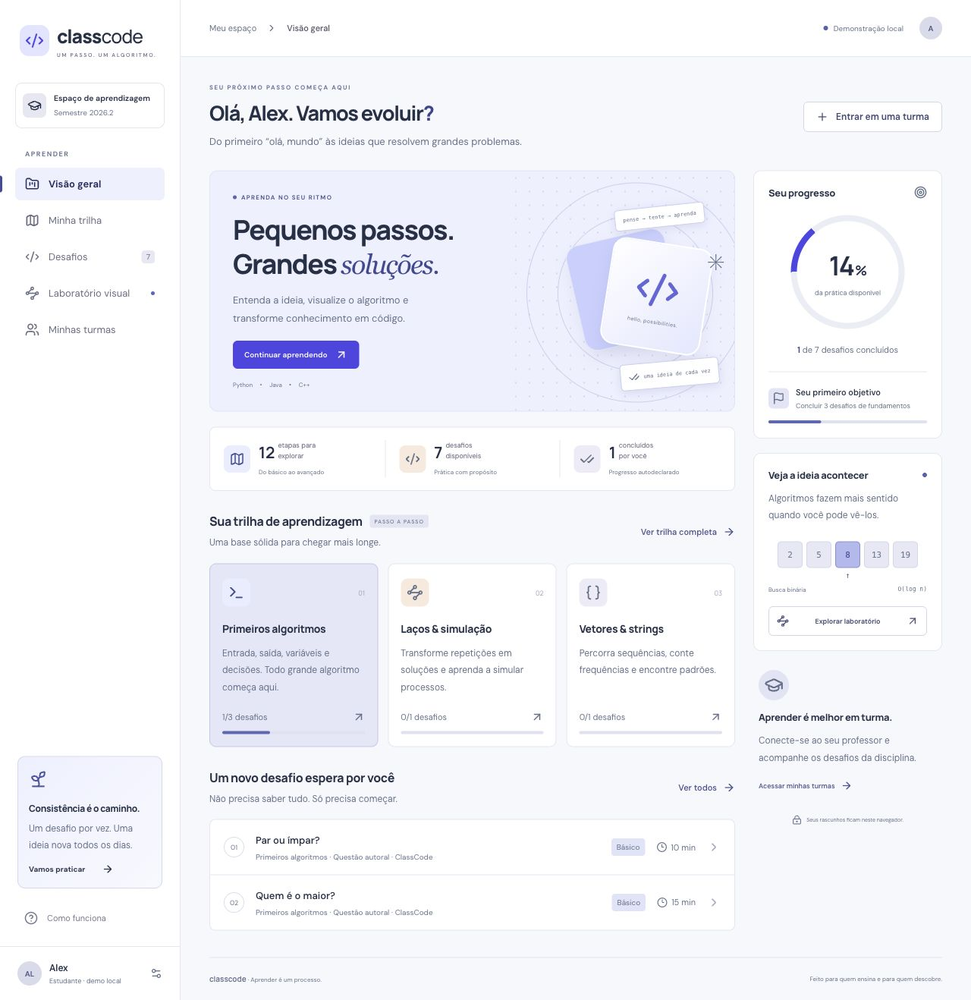

# ClassCode

**Um passo. Um algoritmo.** Plataforma educativa para aprender algoritmos com trilhas progressivas, dicas no tempo certo e acompanhamento por professores.

[Demonstração](https://marcuscspereira.github.io/ClassCode/) · [Plano de desenvolvimento](docs/PLANO.md) · [Entrega 2](docs/ENTREGA-2.md) · [Registro de passagem](docs/PASSAGEM.md) · [Arquitetura](docs/ARQUITETURA.md) · [Design](docs/DESIGN.md) · [Pesquisa](docs/PESQUISA.md)



## O que esta entrega contém

Base React + TypeScript + Vite, com design responsivo e fluxos navegáveis. **É uma demonstração local, não um sistema institucional pronto para uso.** Não exige conta, chave de API ou serviço pago.

| Funcionalidade | Estado nesta base |
| --- | --- |
| Dashboard, desafios, turmas e painel do professor | Interface funcional com dados locais |
| Trilha do básico ao avançado | 12 etapas mapeadas; 7 desafios nas 5 primeiras |
| Criar turma e entrar com código | Funciona no mesmo navegador; experimente `CLASS26` |
| Professor criar questão no padrão pedagógico | Formulário validado e publicação local |
| Dicas em 3, 7 e 12 minutos | Cronômetro local persistido; não é um controle de acesso real |
| Python 3, Java e C++17 | Editor CodeMirror com realce de sintaxe, indentação, linhas e rascunhos por linguagem |
| Modo claro/escuro | Botão no topo e preferência salva; primeira abertura em modo escuro |
| Visualizações | Busca binária e bubble sort com passos, reprodução e pseudocódigo |
| Avaliação de código | Links para CSES; conclusão autodeclarada com reflexão |
| Login e autorização reais | Ainda não conectados; alternância de perfil é demonstrativa |
| Backend institucional | Migração PostgreSQL/Supabase com RLS e RPCs, isolada do frontend |
| Judge integrado | Contrato TypeScript preparado; execução ainda não implementada |

As questões autorais são conteúdo do projeto. Problemas externos são referenciados e abertos no judge de origem; a aplicação não espelha um catálogo de terceiros.

## Rodar em desenvolvimento

Node.js **24 LTS recomendado** (mínimo 22.12) e npm.

```bash
git clone https://github.com/MarcusCSPereira/ClassCode.git
cd ClassCode
npm ci
npm run dev
```

Abra o endereço mostrado pelo Vite, normalmente `http://127.0.0.1:5173`. A demonstração usa `localStorage`; turmas criadas em outro navegador ou dispositivo não aparecem aqui. Uma única identidade e um único conjunto de dados são compartilhados entre as perspectivas locais.

## Experimentar os fluxos

1. Clique em **Começar minha jornada**, escreva um rascunho e troque a linguagem.
2. Abra **Dicas progressivas**. A primeira dica libera após três minutos desde a abertura do desafio.
3. Em **Laboratório visual**, avance uma comparação e compare com o pseudocódigo.
4. Clique no avatar, selecione **Professor** e acesse a demonstração.
5. Crie uma turma, publique um desafio e exporte o conteúdo em JSON.
6. Volte à perspectiva **Estudante** e entre pelo código da turma criada no mesmo navegador.

## Validação

```bash
npm run check           # TypeScript, testes de domínio e build
npx playwright install chromium
npm run test:e2e        # Fluxos em desktop e celular
```

Com PostgreSQL 16+ (`initdb`, `pg_ctl` e `psql`) no PATH:

```bash
bash tests/test-db.sh   # Banco temporário, sem listener TCP; encerrado ao final
```

O CI executa domínio, build, navegação e permissões do banco. Os testes SQL emulam `auth.uid()` e `auth.users` em PostgreSQL: **não substituem homologação no Supabase real**. Consulte [VALIDACAO.md](docs/VALIDACAO.md) para os resultados e limites da entrega.

## Estrutura

```text
src/
  App.tsx                  Navegação, barra lateral e composição das telas
  pages/                   Uma tela por arquivo (visão geral, trilha, desafios, prática...)
  modals/                  Diálogos: turma, perfil, conclusão, ajuda e tópico
  components/              Componentes reutilizáveis, editor e visualizador
  data/repository.ts       Contrato entre a interface e a fonte de dados
  data/demoRepository.ts   Implementação da demonstração sobre localStorage
  lib/catalog.ts           Currículo, questões iniciais e templates de linguagem
  lib/domain.ts            Regras de dicas, conteúdo e demonstração
  lib/algorithms.ts        Geradores de passos das animações
  lib/judge.ts             Contrato para a futura avaliação de código
  styles.css               Sistema visual e layouts responsivos
supabase/
  migrations/              Modelo relacional, RLS e RPCs
  seed.sql                 As 12 etapas do currículo
tests/                     Fluxos Playwright e regressões SQL
docs/                      Plano, decisões, pesquisa, design e roteiro
.github/workflows/         Qualidade e publicação da demonstração
```

## Publicação

A demonstração estática usa GitHub Pages e navegação por hash, compatível com o caminho `/ClassCode/`. O workflow `Publish demo` publica após o `Quality` passar na `main`. Para outra conta, atualize links e habilite **Settings → Pages → Source: GitHub Actions**.

A integração futura com Supabase utiliza apenas a URL e a chave publicável no navegador. **Chaves administrativas e credenciais do Judge0 pertencem ao servidor.** O arquivo `.env.example` é apenas a previsão desse contrato; nenhuma variável é consumida nesta versão.

## Como o time continua

Comece por [CONTRIBUTING.md](CONTRIBUTING.md) e pela entrada mais recente do [registro de passagem](docs/PASSAGEM.md), que diz o próximo passo esperado. Execute os itens do [backlog](docs/PLANO.md#backlog-executável) em ordem de dependência. A [Entrega 2](docs/ENTREGA-2.md) transforma a demonstração em um fluxo multiusuário persistente e acrescenta a trilha adaptativa e as métricas do professor. O judge integrado é a extensão seguinte.

Licença MIT para o código e o conteúdo autoral deste repositório. Referências, marcas e enunciados de terceiros mantêm suas próprias condições de uso.
