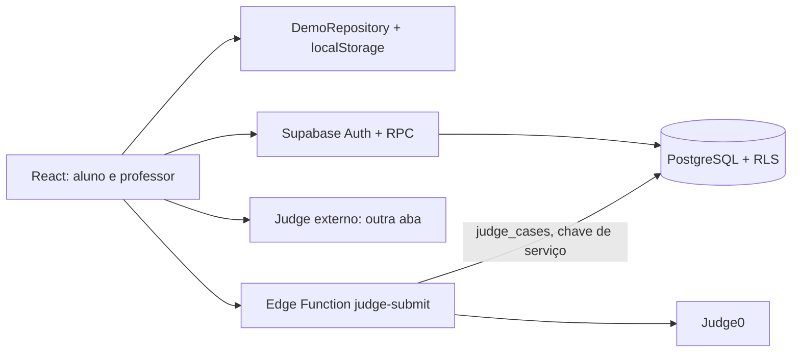
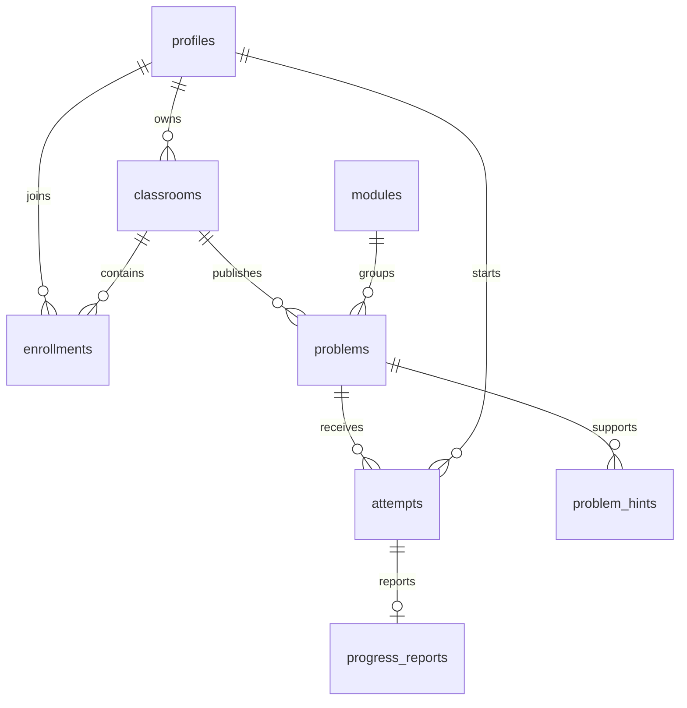

# Arquitetura e contrato de continuidade

## Estado atual

SPA em React/TypeScript/Vite com dois modos explícitos. `VITE_DATA_MODE=demo` usa `localStorage` em `classcode.demo.v1`; `VITE_DATA_MODE=remote` usa Supabase Auth e somente RPCs públicas controladas. A execução de código usa Judge0 por um servidor, o local do `npm run dev` ou a Edge Function `judge-submit` ([JUDGE-API.md](JUDGE-API.md)); o site estático publicado não tem judge. `src/lib/types.ts` continua sendo o contrato da interface, não um modelo gerado do banco.

Cada tela fica em `src/pages/`, cada modal em `src/modals/`, e as operações persistentes passam pela interface `ClassCodeRepository`. O `DemoRepository` usa a store local; o `SupabaseRepository` mapeia todos os métodos do contrato para RPCs e valida os payloads antes de entregá-los à UI. No remoto, perfil, turmas, questões e atividade são carregados do servidor; apenas rascunhos de código e reflexões do laboratório permanecem locais.



## Backend fornecido

`supabase/migrations/202611020001_core.sql` destina-se a um **projeto Supabase novo de desenvolvimento**. Aplicar pelo SQL Editor ou pelo pipeline de migrations da equipe; depois aplicar `supabase/seed.sql`. Não executar `tests/db-bootstrap.sql` no Supabase: ele emula Auth apenas para testes locais e CI.

| Entidade                         | Papel                                                                           |
| -------------------------------- | ------------------------------------------------------------------------------- |
| `profiles`                       | Nome e papel; registro nasce como aluno independentemente de metadados enviados |
| `classrooms`                     | Uma turma pertence a um professor                                               |
| `enrollments`                    | Participação única por aluno/turma                                              |
| `modules`                        | Currículo inicial de 12 etapas                                                  |
| `problems`                       | Questão estruturada por turma; começa como rascunho                             |
| `attempts`                       | Início único por aluno/questão, registrado pelo servidor                        |
| `progress_reports`               | Evidência autodeclarada; não contém veredito Accepted                           |
| `private.class_invites`          | Convites com 128 bits aleatórios; sem leitura pelo cliente                      |
| `private.problem_hints`          | Conteúdo de dicas sem permissão de leitura direta                               |
| `private.hint_views`             | Auditoria de dicas reveladas                                                    |
| `private.base_problem_templates` | Sete modelos da trilha-base, incluindo dicas fora da leitura do cliente         |
| `private.classroom_base_imports` | Controle idempotente dos modelos já importados por turma                        |



### RPCs implementadas no SQL

| Chamada                                                         | Resultado/garantia                                                                                 |
| --------------------------------------------------------------- | -------------------------------------------------------------------------------------------------- |
| `create_classroom(class_name, class_term)`                      | Professor cria turma e recebe `{id, code}`                                                         |
| `join_classroom(invite_code)`                                   | Matrícula idempotente pelo código; retorna UUID da turma                                           |
| `start_attempt(pid)`                                            | Cria tentativa ou devolve o mesmo início existente                                                 |
| `set_problem_hints(pid, hints text[])`                          | Proprietário configura exatamente 3 dicas, com atrasos fixados no servidor                         |
| `get_hint(pid, hint_number)`                                    | Verifica turma, publicação e tempo; retorna somente a dica liberada e registra leitura             |
| `my_profile()`                                                  | Identidade e papel definidos pelo servidor                                                         |
| `list_classrooms()` / `list_problems()`                         | Leituras filtradas pela propriedade/matrícula, sem expor convites ou textos de dicas indevidos     |
| `publish_problem(payload)`                                      | Valida, cria rascunho, configura três dicas e publica atomicamente                                 |
| `report_progress(pid, report_evidence)` / `reopen_problem(pid)` | Registra ou remove conclusão autodeclarada                                                         |
| `my_activity()` / `classroom_activity(cid)`                     | Atividade do aluno e relatório restrito ao proprietário                                            |
| `import_base_trail(cid)`                                        | Importa os sete modelos privados uma única vez por turma, com seus casos de teste                  |
| `save_problem(payload)`                                         | Cria rascunho ou edita questão própria (campos, 3 dicas e até 19 casos ocultos) sem mudar o estado |
| `get_problem_for_edit(pid)`                                     | Só o dono: questão completa com texto das dicas, casos ocultos, estado e nº de alunos que abriram  |
| `set_problem_status(pid, new_status)`                           | Só o dono: `draft`, `published` ou `archived` (arquivar despublica e pode ser desfeito)            |
| `judge_cases(pid, requester)`                                   | Só a chave de serviço (função do judge): casos de teste se o requisitante for dono ou matriculado  |

Ciclo da questão (Entrega 4, CC-24): `save_problem` cria o rascunho, `get_problem_for_edit` o reabre para edição e `set_problem_status` publica, arquiva ou restaura. Um trigger impede publicar sem as três dicas. `list_problems` devolve ao dono os rascunhos e as arquivadas (campo `status`) e aos alunos só as publicadas. `publish_problem` continua existindo para compatibilidade, mas a interface não o usa mais.

### Provisionamento de professor

O navegador não recebe privilégio de alterar `profiles.role`. Inicialmente, um operador confiável promove o usuário no SQL Editor do ambiente de desenvolvimento, por UUID:

```sql
-- Substituir o UUID pelo usuário correto; executar somente como operador do banco.
update public.profiles set role = 'teacher' where id = '<UUID_DO_USUARIO>';
```

Isso é um procedimento de operação inicial, não um endpoint a expor no cliente. Em produção, definir autorização institucional para provisionamento e revogação de professores.

### O que falta no backend

- RPC de leitura/rotação de convite exclusiva do proprietário; atualmente o código volta na criação.
- Geração de tipos do schema, retry por consulta e tratamento dedicado de sessão expirada além da renovação automática do cliente.
- Persistência remota de rascunhos, revisão docente, arquivo de turmas e versionamento de questões.
- Limites de payload, quotas e rate limiting em endpoints/convites; convites expiráveis e revogáveis.
- Homologar grants, migrations e funções no Supabase real; o teste local usa Auth emulado.
- Na implantação institucional, validar política de retenção e de exclusão de dados com a instituição.

O schema já nega acesso aos dados privados por padrão; as funcionalidades acima permanecem pendentes e não são simuladas como prontas no painel.

## Migração do frontend

1. Manter `DemoState` exclusivamente no modo demo. Não usar o seletor de papel para login real.
2. ~~Criar adaptadores por entidade.~~ A interface única e as implementações demo/remota estão ligadas à UI (CC-02/CC-03).
3. Mapear `moduleId → module_id`, `input → input_spec`, dificuldades PT-BR → enum do banco e demais campos explicitamente.
4. ~~Substituir IDs de catálogo por UUIDs de questões persistidas.~~ A trilha-base cria questões com UUID por turma e registra o modelo de origem em tabela privada.
5. **Remover textos de dicas do catálogo/bundle do modo institucional.** Buscar cada dica por `get_hint`, depois da autorização do servidor.
6. ~~Usar `start_attempt` e horário retornado pelo servidor.~~ O modo remoto usa o horário da RPC; o contador visual não é a autoridade.
7. Introduzir estados `loading`, `empty`, `error`, retry e sessão expirada em cada consulta.
8. Adicionar comparação de dados entre dois navegadores e testes de acesso direto à API.

## Judge integrado

Implementado em [JUDGE-API.md](JUDGE-API.md). Situação dos passos do fluxo planejado:

1. ✅ Cliente envia `problemId`, linguagem, código e chave de idempotência. Sem casos de teste, exceto questões que só existem na demo local.
2. ⚠️ Servidor verifica sessão, matrícula ou dono, questão publicada (o dono roda rascunhos), tamanho e linguagem. **Faltam quotas e limite de frequência.**
3. ❌ Submissão persistida: fatia 2 da [Entrega 4](ENTREGA-4.md).
4. ✅ Casos privados em `private.problem_tests`, lidos só pela função com a chave de serviço; execução síncrona com limites de CPU e memória.
5. ❌ Veredito persistido e progresso verificado: fatia 2.
6. ✅ Nunca devolve saída de caso oculto; ❌ consulta de submissões pelo professor depende da fatia 2.

Não rodar `exec`, `eval`, compiladores ou processos dos alunos no processo web. Não enviar credenciais Judge0 no bundle. Não aceitar veredito vindo do navegador. O visualizador não deve executar código do editor: ele reproduz frames determinísticos de algoritmos conhecidos.

## Hospedagem

Demonstração: build estático em GitHub Pages, sem judge: o botão de execução aparece desabilitado com explicação. Remoto: frontend estático, Supabase para Auth/PostgreSQL e a Edge Function `judge-submit` para execução. O Pages não hospeda APIs. Valores de ambiente `VITE_*` são públicos durante o build; apenas URL e chave publicável podem entrar ali.
