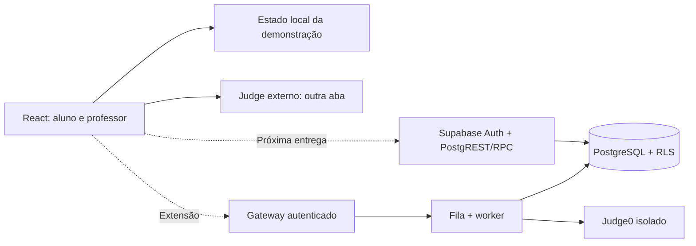
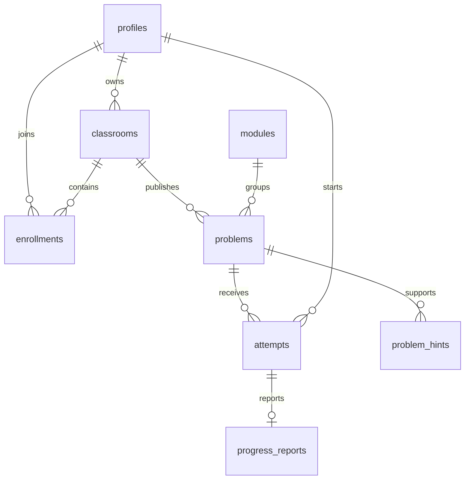

# Arquitetura e contrato de continuidade

## Estado atual

SPA em React/TypeScript/Vite. Navegação por hash; `localStorage` guarda dados em `classcode.demo.v1`. Não existe conexão de rede com Supabase ou Judge0. `src/lib/types.ts` é o contrato da demonstração, não um modelo gerado do banco.

Desde o CC-00, cada tela fica em `src/pages/`, cada modal em `src/modals/`, e as escritas passam pela interface `ClassCodeRepository` de `src/data/repository.ts`. O `DemoRepository` a implementa sobre uma store local (`src/data/demoStore.ts`, estado versão 2 com migração da v1). As leituras ainda vêm da store; CC-03 as move para o repositório e adiciona a implementação Supabase. Contrato e pendências: [ENTREGA-2.md](ENTREGA-2.md#7-contrato-de-repositório).



## Backend fornecido

`supabase/migrations/202611020001_core.sql` destina-se a um **projeto Supabase novo de desenvolvimento**. Aplicar pelo SQL Editor ou pelo pipeline de migrations da equipe; depois aplicar `supabase/seed.sql`. Não executar `tests/db-bootstrap.sql` no Supabase: ele emula Auth apenas para testes locais e CI.

| Entidade | Papel |
| --- | --- |
| `profiles` | Nome e papel; registro nasce como aluno independentemente de metadados enviados |
| `classrooms` | Uma turma pertence a um professor |
| `enrollments` | Participação única por aluno/turma |
| `modules` | Currículo inicial de 12 etapas |
| `problems` | Questão estruturada por turma; começa como rascunho |
| `attempts` | Início único por aluno/questão, registrado pelo servidor |
| `progress_reports` | Evidência autodeclarada; não contém veredito Accepted |
| `private.class_invites` | Convites com 128 bits aleatórios; sem leitura pelo cliente |
| `private.problem_hints` | Conteúdo de dicas sem permissão de leitura direta |
| `private.hint_views` | Auditoria de dicas reveladas |



### RPCs implementadas no SQL

| Chamada | Resultado/garantia |
| --- | --- |
| `create_classroom(class_name, class_term)` | Professor cria turma e recebe `{id, code}` |
| `join_classroom(invite_code)` | Matrícula idempotente pelo código; retorna UUID da turma |
| `start_attempt(pid)` | Cria tentativa ou devolve o mesmo início existente |
| `set_problem_hints(pid, hints text[])` | Proprietário configura exatamente 3 dicas, com atrasos fixados no servidor |
| `get_hint(pid, hint_number)` | Verifica turma, publicação e tempo; retorna somente a dica liberada e registra leitura |

Publicar uma questão requer inserir `published=false`, configurar as dicas e atualizar `published=true`. Um trigger impede publicação sem as três dicas. O time deve encapsular esse fluxo em um serviço de aplicação e tratar falhas, evitando deixar a UI em estado indefinido.

### Provisionamento de professor

O navegador não recebe privilégio de alterar `profiles.role`. Inicialmente, um operador confiável promove o usuário no SQL Editor do ambiente de desenvolvimento, por UUID:

```sql
-- Substituir o UUID pelo usuário correto; executar somente como operador do banco.
update public.profiles set role = 'teacher' where id = '<UUID_DO_USUARIO>';
```

Isso é um procedimento de operação inicial, não um endpoint a expor no cliente. Em produção, definir autorização institucional para provisionamento e revogação de professores.

### O que falta no backend

- Conectar Auth e repositórios ao frontend; gerar tipos do schema e tratar estados de rede.
- RPC de leitura/rotação de convite exclusiva do proprietário; atualmente o código volta na criação.
- Leitura de nomes dos alunos para o proprietário. `profiles` lê apenas o próprio perfil nesta base; estender com teste de isolamento, não com política pública.
- Relatório de uso de dicas para o proprietário; `private.hint_views` continua inacessível ao navegador.
- Os dois itens anteriores têm proposta de contrato nas RPCs `classroom_activity` e `my_activity` (CC-18, [ENTREGA-2.md](ENTREGA-2.md#63-fonte-de-dados-e-cálculo)).
- Persistência remota de rascunhos, revisão docente, arquivo de turmas e versionamento de questões.
- Limites de payload, quotas e rate limiting em endpoints/convites; convites expiráveis e revogáveis.
- Homologar grants, migrations e funções no Supabase real; o teste local usa Auth emulado.
- Na implantação institucional, validar política de retenção e de exclusão de dados com a instituição.

O schema já nega acesso aos dados privados por padrão; as funcionalidades acima permanecem pendentes e não são simuladas como prontas no painel.

## Migração do frontend

1. Manter `DemoState` exclusivamente no modo demo. Não usar o seletor de papel para login real.
2. ~~Criar adaptadores por entidade.~~ Substituído por uma interface única, `ClassCodeRepository`, já usada pelas escritas (CC-00). Falta a implementação Supabase e o login (CC-02/CC-03).
3. Mapear `moduleId → module_id`, `input → input_spec`, dificuldades PT-BR → enum do banco e demais campos explicitamente.
4. Substituir IDs de catálogo por UUIDs de questões persistidas. O seed atual contém somente módulos.
5. **Remover textos de dicas do catálogo/bundle do modo institucional.** Buscar cada dica por `get_hint`, depois da autorização do servidor.
6. Usar `start_attempt` e horário retornado pelo servidor. O contador visual não é a autoridade.
7. Introduzir estados `loading`, `empty`, `error`, retry e sessão expirada em cada consulta.
8. Adicionar comparação de dados entre dois navegadores e testes de acesso direto à API.

## Judge integrado: contrato futuro

O contrato `JudgeGateway` em `src/lib/judge.ts` prevê submissão e consulta de resultado. Não possui implementação falsa de Accepted.

Fluxo recomendado:

1. Cliente envia `problemId`, linguagem, código e chave de idempotência para gateway autenticado.
2. Servidor verifica matrícula, questão publicada, tamanho, quotas e linguagem permitida.
3. Cria submissão `queued`; guarda código com política de retenção definida.
4. Worker lê testes privados, descobre/mapeia linguagens na instância Judge0 e executa com limites.
5. Worker agrega resultados, persiste veredito e atualiza progresso verificado; callbacks/polling são validados no servidor.
6. Cliente consulta apenas suas submissões; professor consulta as da própria turma. Não devolver testes ocultos completos.

Não rodar `exec`, `eval`, compiladores ou processos dos alunos no processo web. Não enviar credenciais Judge0 no bundle. Não aceitar veredito vindo do navegador. O visualizador não deve executar código do editor: ele reproduz frames determinísticos de algoritmos conhecidos.

## Hospedagem

Demonstração: build estático em GitHub Pages. Futuro: manter frontend estático, Supabase para Auth/PostgreSQL e gateway/worker separado para execução. O Pages não hospeda APIs ou workers de judge. Valores de ambiente `VITE_*` são públicos durante o build; apenas URL e chave publicável podem entrar ali.
