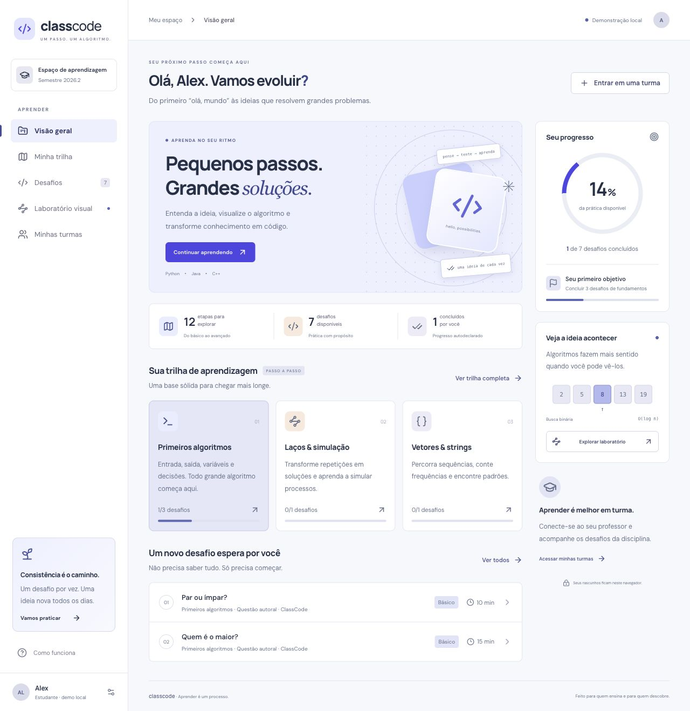
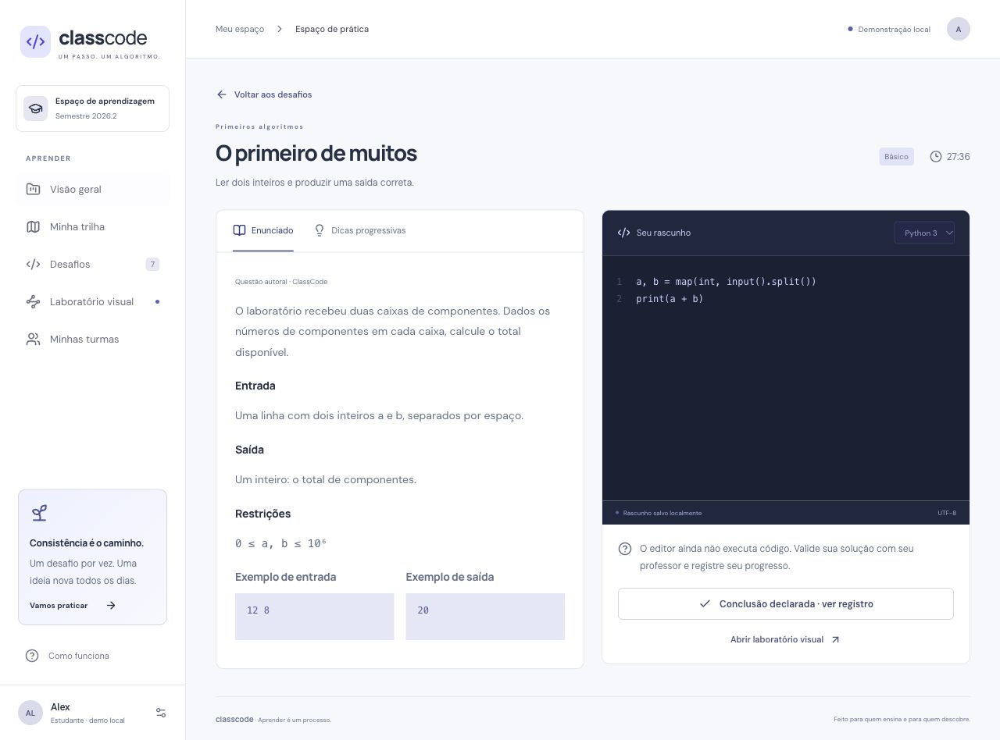
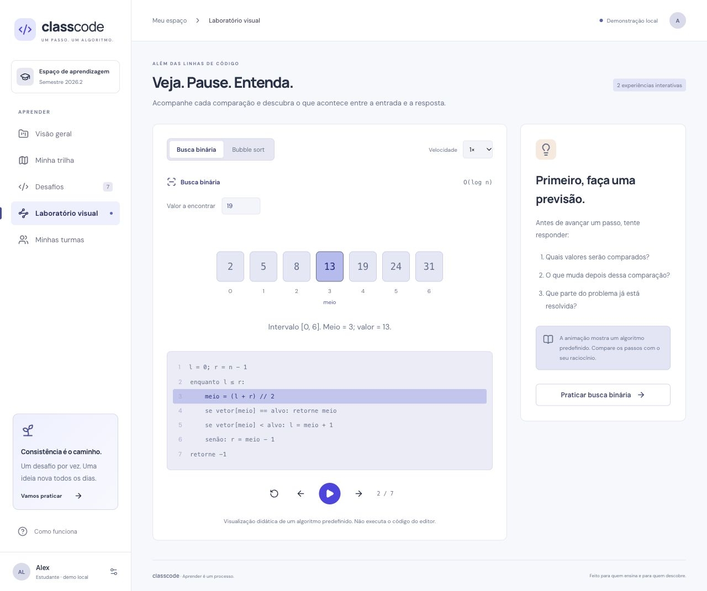
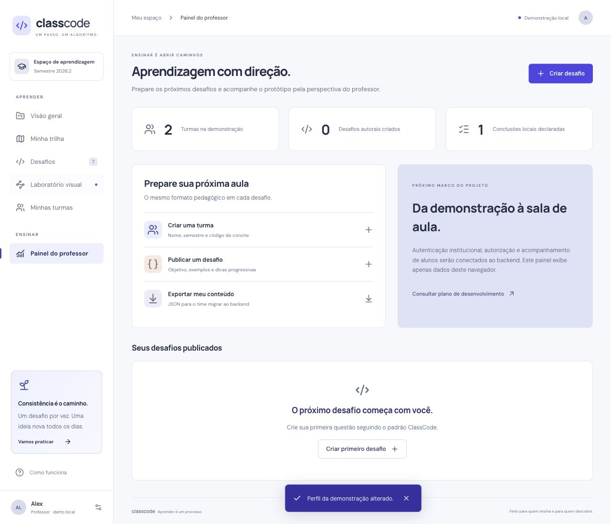

# Design inicial

Direção: um ambiente de aprendizagem calmo e universitário, com azul índigo, fundos neutros, detalhes em violeta e ilustrações geométricas de código. A linguagem incentiva tentativa e compreensão, sem transformar a disciplina em um ranking competitivo.

## Telas entregues

| Tela/fluxo | Função |
| --- | --- |
| Visão geral | Próximo desafio, progresso, etapas iniciais e acesso às turmas |
| Minha trilha | 12 etapas, filtro por nível, pré-requisitos sugeridos e desafios por tópico |
| Desafios | Busca por título/tópico, dificuldade, duração e estado de conclusão |
| Espaço de prática | Objetivo, enunciado, entrada/saída, restrições, exemplos, dicas e rascunho |
| Laboratório visual | Busca binária e bubble sort, passo anterior/próximo, reprodução, velocidade e pseudocódigo |
| Minhas turmas | Nome, professor, semestre, código e desafios associados |
| Perfil demonstrativo | Nome e escolha explícita da perspectiva de aluno/professor |
| Painel do professor | Criação de turmas/questões, números locais e exportação JSON |
| Nova questão | Formulário completo no padrão pedagógico |
| Registro de conclusão | Reflexão ou evidência e declaração explícita de validação |

Também foi revisado o [dashboard em celular de 390 px](images/mobile.jpg), com navegação lateral recolhida e cards em uma coluna.

## Tokens e componentes

| Token | Valor/base | Aplicação |
| --- | --- | --- |
| Azul profundo | `#202947` | Títulos e identidade |
| Índigo de ação | `#4f46e5` | Ações principais |
| Fundo | `#f7f8fc` | Área de estudo |
| Superfície | `#ffffff` | Cartões e formulários |
| Azul suave | `#e9edff` | Destaques pedagógicos |
| Texto secundário | `#63708a` / `#64708b` | Descrições e ajuda |
| Borda | `#e4e7f0` | Divisões leves |
| Tipografia | Manrope + DM Sans | Títulos e texto; fallbacks de sistema |
| Código | SFMono / Consolas / Liberation Mono | Editor e pseudocódigo |

Componentes reutilizáveis: botão primário/secundário/texto, card de tópico, linha de desafio, badge, barra/anel de progresso, modal nativo, formulário e player de algoritmos. Ícones Lucide. A ilustração do hero usa CSS, sem dependência de imagem externa ou geração de marca.

As fontes são carregadas do Google Fonts; os fallbacks mantêm a aplicação utilizável sem esse serviço. Para implantação institucional com restrição de rede, hospedar os arquivos das fontes conforme suas licenças.

## Responsividade e acessibilidade

- Sidebar fixa em desktop; menu lateral acionável em celular.
- Cards e workspace passam a uma coluna conforme a largura.
- Formulários usam labels e campos nativos; modal usa `dialog` e devolve o foco ao controle de abertura.
- Controles de animação têm rótulos; alterações de frame usam `aria-live`.
- Progresso também aparece em texto; status não depende somente de cor.
- Foco visível e suporte a `prefers-reduced-motion`.
- Em modo institucional, revisar com auditoria automatizada e teclado antes de declarar conformidade WCAG; esta entrega não reivindica certificação.

## Estados e contratos visuais

- Tópico sem questões: “Em preparação”, com currículo e pré-requisitos disponíveis.
- Dica bloqueada: tempo restante e botão desabilitado.
- Busca sem resultado: estado vazio com orientação.
- Código de turma inválido: validação no campo.
- Armazenamento indisponível: aviso de que os dados duram somente na sessão.
- Conclusão: explicitamente autodeclarada; sem mensagem de Accepted.
- Interface institucional futura: adicionar carregamento, indisponibilidade, erro de autorização e sessão expirada ao conectar o backend.
