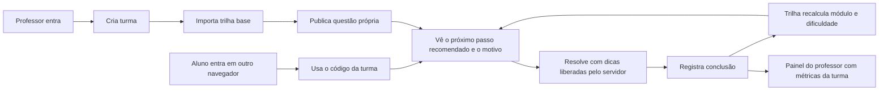
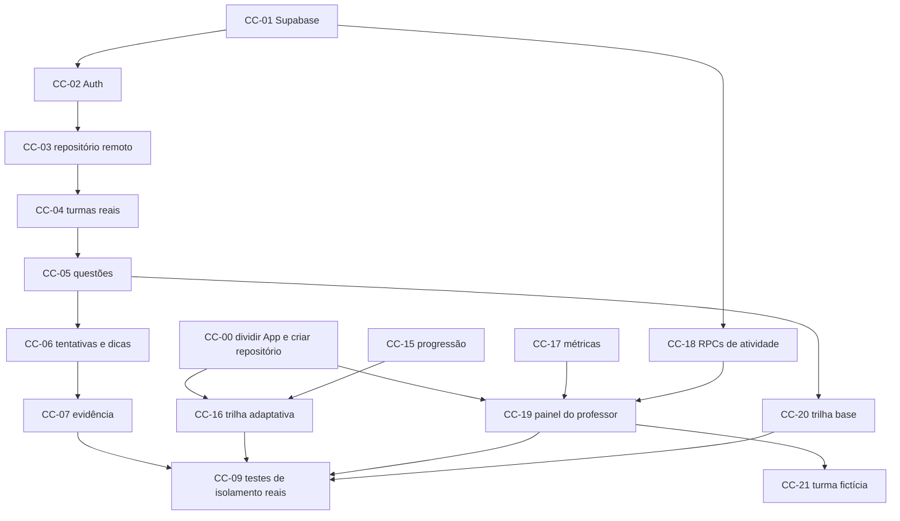

# Entrega 2: MVP conectado, métricas e evolução gradual

Branch: `feat/entrega-2-mvp` · Proposta escrita em 02/11/2026 · Janela: 03–11/11/2026, com integração em 12/11 e apresentação em 15/11, conforme o [PLANO.md](PLANO.md).

Este documento é a **proposta** da próxima entrega. Parte do que existe na `main` (commit `2de1556`), compara com a visão do produto e define backlog, contratos e critérios de aceite. **Nada aqui está implementado ainda.** O que cada pessoa já fez fica registrado em [PASSAGEM.md](PASSAGEM.md).

## 1. Visão do produto

O aluno resolve problemas com **dicas graduais** e **evolui sozinho** por uma trilha que se adapta ao seu desempenho. O professor **extrai métricas** do uso real da plataforma para decidir o que reforçar em aula.

## 2. Diagnóstico: o que está pronto e o que falta

| Pilar | Pronto na base | Lacuna para o MVP |
| --- | --- | --- |
| Resolução com dicas graduais | Espaço de prática, padrão de questão, editor Python/Java/C++, 3 dicas em 3/7/12 min, judge externo, conclusão autodeclarada | Dicas e relógio são locais e manipuláveis; questões vêm do bundle; nada persiste entre dispositivos |
| Métricas para o professor | Painel com 3 contadores do próprio navegador: turmas, desafios criados e conclusões locais | **Nenhuma métrica por aluno, por questão ou por turma.** O banco já registra início, dicas vistas e conclusões, mas o professor não consegue ler nomes nem `hint_views` |
| Evolução automática e gradual | 12 etapas com pré-requisitos sugeridos; "próximo desafio" é o primeiro não concluído da lista; meta fixa "3 desafios de fundamentos" | **Nenhum modelo de domínio, recomendação ou desbloqueio.** A trilha não reage ao desempenho nem ao uso de dicas |
| Plataforma | Migration com RLS e 5 RPCs testadas em PostgreSQL com Auth emulado; CI; GitHub Pages | Supabase real não criado; frontend sem Auth e sem repositório remoto; `App.tsx` concentra todas as telas em 1.464 linhas |

Verificação feita para este diagnóstico (02/11): `npm ci` e `npm run check` passaram, com TypeScript, 10 testes de domínio e build. E2E e testes SQL não foram reexecutados; o último resultado registrado está em [VALIDACAO.md](VALIDACAO.md).

**Conclusão:** o backlog atual (CC-01 a CC-14) cobre bem a plataforma, mas resume as métricas em um único item (CC-08) e não cobre a evolução automática. Esses dois pilares são o diferencial pedagógico do projeto e ganham itens próprios, com as regras escritas antes do código.

## 3. Propostas de escopo

| Proposta | Como funciona | A favor | Contra |
| --- | --- | --- | --- |
| A. Plataforma primeiro | Seguir CC-01 → CC-10 em sequência; métricas e evolução no fim | Menor risco de segurança | O diferencial pedagógico chega por último e é o primeiro a ser cortado |
| B. Pedagogia primeiro | Construir trilha adaptativa e painel de métricas sobre o modo demo; conectar o backend depois | Mostra valor cedo | Não cumpre o critério de usuários reais; repete o risco "UI pronta sem autorização" apontado no PLANO |
| **C. Duas frentes sobre um contrato (recomendada)** | A frente Plataforma faz Auth, RPCs e repositório remoto. A frente Pedagógica faz progressão e métricas como funções puras testadas, com UI ligada a uma interface de repositório que já funciona no modo demo. As frentes convergem em 10–11/11 | Paralelismo com poucos conflitos de arquivo; regras pedagógicas testáveis sem rede; o modo demo continua como contingência honesta | Exige o contrato da seção 7 e a divisão do `App.tsx` antes de começar |

A proposta C depende de começar por **CC-00**: dividir o `App.tsx` em páginas e introduzir a interface de repositório. Sem isso, as duas frentes editam o mesmo arquivo o tempo todo.

## 4. Fluxo que a Entrega 2 precisa demonstrar



## 5. Evolução automática e gradual: modelo v1

Regras determinísticas e explicáveis, sem IA: aluno e professor conseguem entender por que uma recomendação apareceu. Implementação em `src/lib/progression.ts`, com funções puras, sem React e sem rede.

### 5.1 Autonomia de uma conclusão

Cada conclusão recebe uma nota de autonomia conforme as dicas reveladas **antes** do registro de conclusão:

| Dicas reveladas | 0 | 1 | 2 | 3 |
| --- | --- | --- | --- | --- |
| Autonomia | 1,00 | 0,75 | 0,50 | 0,25 |

Dicas abertas depois de concluir não reduzem a autonomia, para o aluno poder revisar. No modo demo, enquanto não houver horário de leitura das dicas, todas as reveladas contam.

### 5.2 Estados de um módulo, por aluno

| Estado | Regra | O que a UI mostra |
| --- | --- | --- |
| Em preparação | A turma não tem questões publicadas no módulo | "Em preparação" (já existe) |
| Aguardando pré-requisito | Algum pré-requisito ainda não está Concluído | "Recomendado após X"; continua acessível |
| Disponível | Pré-requisitos concluídos e nenhuma tentativa no módulo | Destaque de "pronto para começar" |
| Em andamento | Há tentativa, mas o critério de conclusão não foi atingido | Progresso `n/meta` |
| Concluído | Conclusões ≥ `min(2, questões publicadas no módulo)` | Libera os módulos dependentes |
| Dominado | Concluído **e** autonomia média ≥ 0,75 | Selo de domínio |

Concluído libera os dependentes mesmo com autonomia baixa, para o aluno nunca ficar travado. Nesse caso a recomendação sugere reforço e o professor vê o sinal. Os parâmetros ficam em uma constante única, `PROGRESSION_RULES`, para ajuste depois da conversa com o professor da disciplina.

**Bloqueio suave:** a trilha continua navegável, como no design atual ("sem bloquear sua curiosidade"). Mudam a recomendação automática e o estado visível. Bloqueio rígido configurável por turma fica para depois do MVP.

Regras de interpretação adotadas na implementação (CC-15):

- **Ordem de avaliação:** Em preparação → Concluído/Dominado → Aguardando pré-requisito → Em andamento → Disponível. Quem atinge o critério de um módulo antes dos pré-requisitos, aproveitando o bloqueio suave, tem o módulo Concluído e libera os dependentes. Uma tentativa em módulo Aguardando não o torna Em andamento.
- **Pré-requisito sem questões é transparente:** ele não tem o que concluir, então valem os pré-requisitos dele. Exemplo: se o professor publicar questões em Gulosos, que depende de Dois ponteiros (ainda sem questões), Gulosos fica liberado quando Complexidade, o pré-requisito de Dois ponteiros, estiver concluído. `blockedBy` lista os módulos que de fato faltam, já atravessando os vazios.
- **Atividade de desafios não publicados** (removidos ou de outra turma) é ignorada.

### 5.3 Próximo passo recomendado

As regras são avaliadas em ordem; vence a primeira que produzir um desafio. Toda recomendação devolve um `reason`, exibido ao aluno.

1. **Continuar:** o desafio iniciado e não concluído mais recente, em um módulo que não esteja Aguardando pré-requisito. Motivo: "Você começou este desafio e ainda não registrou a conclusão."
2. **Avançar na trilha:** no módulo liberado de menor posição que ainda não está Concluído, escolher uma questão não iniciada:
   - se as duas últimas conclusões tiveram autonomia ≥ 0,75, a de **maior** dificuldade disponível no módulo ("Você resolveu os últimos desafios quase sem dicas.");
   - se as duas últimas tiveram autonomia ≤ 0,50, a de **menor** dificuldade ("Vamos consolidar antes de subir o nível.");
   - caso contrário, a próxima por dificuldade e ordem de cadastro ("Você está pronto para começar <módulo>." se o módulo ainda não tem tentativa; "Próximo passo em <módulo>." se já tem).
   - "As duas últimas" são as duas conclusões mais recentes em toda a trilha, não só no módulo atual. Com menos de duas conclusões, vale o caso padrão.
3. **Reforçar:** se não houver módulo liberado em aberto, sugerir a questão não iniciada mais fácil do módulo Concluído (não Dominado) com menor autonomia ("Vale reforçar <módulo>: você concluiu a etapa com bastante ajuda das dicas."). Sem candidata, a função devolve `null`: a trilha da turma está completa.

A meta fixa "Concluir 3 desafios de fundamentos" passa a ser derivada: "Conclua n de m desafios de <módulo atual>".

### 5.4 Interface implementada (CC-15)

Em [`src/lib/progression.ts`](../src/lib/progression.ts). Todas as funções recebem a atividade de **um** aluno; para a turma (CC-17), chame uma vez por aluno.

```ts
export const PROGRESSION_RULES = { minCompletions: 2, masteryAutonomy: 0.75, lowAutonomy: 0.5 };
export type ModuleStatus =
  'preparing' | 'waiting' | 'available' | 'in_progress' | 'completed' | 'mastered';
export interface ModuleProgress {
  status: ModuleStatus;
  total: number; // questões publicadas no módulo
  required: number; // min(minCompletions, total)
  completed: number;
  started: number;
  autonomy: number | null; // média das conclusões
  blockedBy: string[]; // só quando status === 'waiting'
}
export interface Recommendation {
  kind: 'continue' | 'advance' | 'reinforce';
  problemId: string;
  moduleId: string;
  reason: string;
}
export function autonomy(hintsBeforeCompletion: number): number;
export function hintsBeforeCompletion(row: ActivityRow): number;
export function moduleStatuses(
  modules: Module[],
  problems: ProblemSummary[],
  activity: ActivityRow[],
): Record<string, ModuleProgress>;
export function currentModule(
  modules: Module[],
  progress: Record<string, ModuleProgress>,
): string | null; // "módulo atual" para a meta e para as métricas
export function recommendNext(
  modules: Module[],
  problems: ProblemSummary[],
  activity: ActivityRow[],
): Recommendation | null;
```

`modules` deve vir na ordem da trilha (a posição é a ordem do array) e `problems` na ordem de cadastro.

Casos de teste mínimos, todos cobertos em [`src/lib/progression.test.ts`](../src/lib/progression.test.ts):

- Aluno novo recebe o primeiro desafio de Primeiros algoritmos.
- Duas conclusões sem dica em Fundamentos marcam Dominado e liberam Laços.
- Duas conclusões com 3 dicas liberam Laços, não marcam Dominado, e a recomendação seguinte é a de menor dificuldade.
- Desafio em andamento tem prioridade sobre um novo.
- Módulo sem questões nunca é recomendado.
- Dependência múltipla: Grafos só fica disponível com Estruturas **e** Recursão concluídos.
- Dica aberta depois da conclusão não reduz a autonomia.

## 6. Métricas do professor: catálogo v1

As métricas servem ao **acompanhamento pedagógico**, não a nota automática. As conclusões continuam autodeclaradas e a interface diz isso. Só o professor proprietário da turma vê os dados. Nenhum código-fonte de aluno é exposto nesta entrega.

### 6.1 Definições

Abrir um desafio inicia a tentativa (regra do servidor em `start_attempt`), por isso "Abertos" inclui navegação exploratória.

Por aluno:

| Métrica | Definição | Fonte |
| --- | --- | --- |
| Abertos | Desafios com tentativa | `attempts` |
| Conclusões declaradas | Desafios com registro de conclusão | `progress_reports` |
| Taxa de conclusão | Conclusões / abertos | — |
| Dicas por conclusão | Média de dicas reveladas antes da conclusão | `hint_views` e `progress_reports` |
| Autonomia | % de conclusões sem nenhuma dica | idem |
| Tempo até registrar | Mediana de `reported_at − started_at`; tempo de parede, inclui pausas | `attempts` e `progress_reports` |
| Última atividade | Maior horário entre início, dica e conclusão | todas |
| Módulo atual | Calculado por `progression.ts` | — |

Por questão: alunos que abriram, que concluíram, taxa de conclusão, funil de dicas (% que revelou a 1ª, a 2ª e a 3ª) e tempo mediano até registrar. O ranking **"Questões que mais exigiram ajuda"** ordena pela % que revelou a 3ª dica e, em empate, pela menor taxa de conclusão.

Por turma: matriculados, ativos nos últimos 7 dias, distribuição dos alunos por módulo atual e **mapa aluno × questão** com os estados: não abriu · em andamento · viu k dicas · concluiu sem dica · concluiu com k dicas.

### 6.2 Sinais de atenção

São sinais, não rótulos de desempenho. Aparecem como texto com o motivo.

| Sinal | Regra inicial |
| --- | --- |
| Ainda não começou | Matriculado sem tentativas |
| Inativo | Sem atividade há 7 dias ou mais |
| Travado | 2 ou mais desafios com dica revelada e sem conclusão há mais de 48 h |
| Muito dependente de dicas | 3 ou mais conclusões e média ≥ 2,5 dicas por conclusão |

"Travado" exige dica revelada para não confundir esforço real com navegação exploratória. Os limiares ficam em `METRIC_RULES` para calibração com o professor.

### 6.3 Fonte de dados e cálculo

O schema atual **já registra tudo o que o catálogo v1 precisa**. Falta expor os dados ao professor de forma segura e agregá-los. Decisão proposta: o banco devolve linhas de atividade e a agregação acontece em `src/lib/metrics.ts`, função pura e testada, compartilhada entre o modo demo e o modo remoto.

```ts
export interface ActivityRow {
  studentId: string;
  problemId: string;
  startedAt: string; // ISO, horário do servidor
  hintViews: { ordinal: 1 | 2 | 3; viewedAt: string }[];
  reportedAt?: string;
  verification?: 'self_reported';
}
export interface RosterEntry {
  studentId: string;
  displayName: string;
  joinedAt: string;
}
```

RPCs novas, em uma **migration nova**. Nunca alterar `202611020001_core.sql`, que pode já ter sido aplicada em algum ambiente.

| RPC | Quem pode chamar | Retorno |
| --- | --- | --- |
| `classroom_activity(cid uuid)` | Apenas o proprietário da turma | `{ roster: RosterEntry[], activity: ActivityRow[] }` dos alunos matriculados |
| `my_activity()` | Aluno autenticado | `ActivityRow[]` do próprio usuário, para a trilha adaptativa e para saber quais dicas já revelou |

Testes SQL obrigatórios: o proprietário lê; outro professor, aluno da turma e aluno de fora recebem negação; `anon` não executa; `my_activity` nunca devolve outro aluno.

**Cuidado de implementação:** `get_hint` registra a leitura. A UI só deve chamá-la quando o aluno clicar em "Revelar dica", nunca automaticamente quando a dica libera; caso contrário, a métrica de dicas fica errada. Depois de recarregar a página, as dicas já reveladas são buscadas de novo (a RPC é idempotente) a partir de `my_activity`.

Depois do MVP: "revelou assim que liberou" (dica aberta em até 30 s da liberação), tempo ativo no editor, evolução semanal e gráficos.

### 6.4 Implementação (CC-17)

Em [`src/lib/metrics.ts`](../src/lib/metrics.ts), com testes em [`src/lib/metrics.test.ts`](../src/lib/metrics.test.ts):

```ts
export const METRIC_RULES = {
  inactiveDays: 7,
  stuckHours: 48,
  stuckProblems: 2,
  dependentCompletions: 3,
  dependentHints: 2.5,
};
export function classroomMetrics(
  modules: Module[],
  problems: ProblemSummary[], // questões publicadas da turma, na ordem de cadastro
  activity: ClassroomActivity, // o que repository.classroomActivity() devolve
  now: number, // referência para "ativo", "inativo" e "travado"
): ClassroomMetrics; // students, problems, mostHelpNeeded, moduleDistribution, map, enrolled, activeLastWeek
export function describeCell(cell: MapCell): string; // "Viu 2 dicas", "Concluiu sem dica"...
export function studentsCsv(students: StudentMetrics[], modules: Module[], options?: { timeZone?: string }): string;
```

Interpretações adotadas onde as seções 6.1 e 6.2 deixavam margem:

- **Dicas que contam como ajuda:** as abertas até a conclusão, ou todas, enquanto o desafio não foi concluído. É a mesma regra da autonomia da trilha.
- **Funil de dicas:** conta por número da dica, porque o aluno pode abrir a 3ª sem abrir a 2ª. O denominador é quem abriu a questão.
- **Questões que mais exigiram ajuda:** questões que ninguém abriu ficam fora do ranking.
- **Travado:** a tentativa foi aberta há mais de 48 h, tem ao menos uma dica e não tem conclusão.
- **Inativo** vale só para quem já abriu algum desafio; quem nunca abriu recebe "Ainda não começou".
- **Ativo nos últimos 7 dias:** última atividade há menos de 7 dias.
- **Etapa atual:** vem de `currentModule`; sem etapa em aberto (trilha concluída ou turma sem questões), aparece como "Sem etapa em aberto".
- **Atividade fora da turma:** de alunos que não estão mais matriculados ou de questões não publicadas, é ignorada.
- **CSV para planilhas em português:** separador `;`, vírgula decimal, BOM UTF-8 e quebras CRLF. Células que começam com `=`, `+`, `-` ou `@` recebem `'` na frente para não virarem fórmula, porque o nome é digitado pelo aluno. Os títulos das colunas dizem "Conclusões autodeclaradas" e "Sinais de atenção (não são nota)".

## 7. Contrato de repositório

A UI depende de uma interface implementada pelo modo demo e, a partir de CC-03, pelo modo remoto. Nenhuma tela chama `localStorage` ou Supabase diretamente. **Implementado no CC-00** em [`src/data/repository.ts`](../src/data/repository.ts):

```ts
export interface ClassCodeRepository {
  readonly mode: 'demo' | 'remote';
  listClassrooms(): Promise<Classroom[]>;
  createClassroom(name: string, term: string): Promise<{ id: string; code: string }>;
  joinClassroom(code: string): Promise<string>;
  listProblems(): Promise<ProblemSummary[]>; // sem o texto das dicas
  publishProblem(problem: NewProblem): Promise<string>;
  startAttempt(problemId: string): Promise<string>; // idempotente; started_at do servidor
  revealHint(problemId: string, ordinal: HintOrdinal): Promise<string>; // registra a leitura
  reportProgress(problemId: string, evidence: string): Promise<void>;
  reopenProblem(problemId: string): Promise<void>;
  myActivity(): Promise<ActivityRow[]>;
  classroomActivity(classroomId: string): Promise<ClassroomActivity>;
}
```

Falhas usam `RepositoryError` com códigos iguais às exceções do SQL (`teacher_required`, `owner_required`, `invalid_invite`, `problem_not_accessible`, `attempt_required`, `hint_locked`, `invalid_problem`, `invalid_evidence`) e mensagem em português; `describeError` produz o texto para a interface. Login (CC-02) e importação da trilha base (CC-20) ainda vão entrar na interface.

Situação dos pontos de atenção:

| Ponto | Situação |
| --- | --- |
| `ProblemSummary` sem texto de dica; telas obtêm o texto por `revealHint` | Feito no CC-00. A tela de prática busca de novo as dicas já vistas ao abrir, como fará no modo remoto |
| `DemoState` versão 2 com horários de leitura de dica e de conclusão, migrando a v1 | Feito no CC-00, com testes de unidade e um E2E que abre dados salvos na v1 |
| Catálogo com dicas fora do bundle no modo remoto | **Pendente (CC-03).** `lib/catalog.ts` mistura currículo (`modules`, `starters`) com as questões e dicas da demo, e é importado pelo `App`, pelo `DemoRepository` e pelas telas. Sugestão: separar em `curriculum.ts` e `demoProblems.ts`, este carregado só pelo `DemoRepository` |
| Leituras pelo repositório, com carregamento e erro | **Pendente (CC-03).** As telas ainda leem o estado local por `useSyncExternalStore`; só as escritas passam pelo repositório |
| Mapeamentos de campos e dificuldade | Seguem a seção "Migração do frontend" de [ARQUITETURA.md](ARQUITETURA.md), em CC-03 |

## 8. Backlog da Entrega 2

CC-01 a CC-14 continuam definidos no [PLANO.md](PLANO.md#backlog-executável). Abaixo estão os itens novos; CC-08 passa a ser atendido por CC-17, CC-18 e CC-19.

**Situação:** CC-00, CC-15, CC-16 e CC-17 concluídos em 02/11 na branch `feat/entrega-2-mvp`; o CC-16 funciona no modo demo e passa a valer para usuários reais com CC-02 a CC-04 (detalhes em [PASSAGEM.md](PASSAGEM.md)). Os demais itens estão abertos.

| ID | Prior. | Frente | Entrega e critério de aceite | Depende de |
| --- | --- | --- | --- | --- |
| CC-00 | P0 | Ambas | Dividir `App.tsx` em `src/pages/*` e componentes; criar `ClassCodeRepository` e `DemoRepository` com o comportamento atual. **Sem mudança visível:** o E2E atual passa sem alterar asserts | — |
| CC-15 | P0 | Pedagógica | `progression.ts` com estados de módulo, autonomia e recomendação da seção 5; testes cobrindo os casos listados | — |
| CC-16 | P0 | Pedagógica | Trilha e visão geral usam CC-15: estado de cada módulo, próximo passo com motivo e meta derivada. E2E: concluir 2 desafios de Fundamentos muda a recomendação para Laços | CC-00, CC-15 |
| CC-17 | P0 | Pedagógica | `metrics.ts` com o catálogo e os sinais da seção 6; testes com turma fictícia (sem tentativas, inativo, travado, dependente de dicas) | — |
| CC-18 | P0 | Plataforma | Migration nova com `classroom_activity` e `my_activity`; testes SQL de permitir e negar | CC-01 |
| CC-19 | P0 | Pedagógica | Painel do professor: resumo da turma, tabela por aluno com sinais, questões que mais exigiram ajuda, mapa aluno × questão e exportação CSV; estados de carregamento, vazio e erro. Funciona com `DemoRepository` e depois com o remoto | CC-00, CC-17; CC-18 no remoto |
| CC-20 | P0 | Plataforma | Trilha base no servidor: modelos das 7 questões, com dicas, em tabela privada do seed; RPC `import_base_trail(cid)` idempotente e só do proprietário; botão "Importar trilha base" ao criar turma | CC-05 |
| CC-21 | P1 | Pedagógica | Turma fictícia no modo demo, com 6–8 alunos e atividade gerada de forma determinística, identificada na UI como dados fictícios, para demonstrar o painel sem depender da rede | CC-19 |



## 9. Cronograma da entrega

| Data | Frente Plataforma | Frente Pedagógica |
| --- | --- | --- |
| 03/11 | Decisões da seção 10; CC-00 em conjunto, em um PR curto mesclado antes de tudo | CC-00 em conjunto |
| 04–06/11 | CC-01, CC-02, CC-03, CC-04 | CC-15 e CC-17: funções puras e testes |
| 07–09/11 | CC-05, CC-20, CC-06, CC-07, CC-18 | CC-16 e CC-19 sobre o `DemoRepository`; CC-21 se houver folga |
| 10–11/11 | CC-09 no Supabase real | Ligar CC-16 e CC-19 ao repositório remoto |
| 12/11 | Integração e regra de corte do PLANO | Integração e regra de corte do PLANO |

**Regra de corte desta entrega:** se CC-04 não estiver integrado em 09/11, a frente Pedagógica passa a ajudar a Plataforma, e as telas novas são apresentadas no modo demo, identificadas como tal. O judge integrado (CC-13 e CC-14) continua fora. Métricas nunca exibem dados simulados como se fossem reais.

## 10. Decisões pendentes do time

| # | Decisão | Opções | Recomendação |
| --- | --- | --- | --- |
| D1 | Ambiente do Supabase | Projeto na nuvem, na conta de alguém do time · stack local com Supabase CLI e Docker | Nuvem de desenvolvimento, porque o critério do MVP exige dispositivos diferentes. CLI local é opcional para quem tiver Docker |
| D2 | Bloqueio da trilha | Suave: recomenda, tudo acessível · rígido | Suave no MVP |
| D3 | Parâmetros da evolução | 2 conclusões por módulo; autonomia ≥ 0,75 para Dominado | Adotar e validar com o professor da disciplina |
| D4 | Limiares dos sinais | 7 dias · 48 h · 2,5 dicas | Adotar e calibrar no teste de usabilidade de 13/11 |
| D5 | Responsáveis | Quem assume cada frente | Ao menos uma pessoa por frente; quem é de uma frente revisa os PRs da outra |

Registre cada decisão tomada em [PASSAGEM.md](PASSAGEM.md) e atualize esta tabela.

## 11. Critérios de aceite da Entrega 2

- [ ] Professor e aluno reais, em navegadores diferentes, completam o fluxo da seção 4.
- [ ] A recomendação muda sozinha depois que o aluno conclui um módulo, e a tela explica o motivo.
- [ ] Dicas reveladas reduzem a autonomia; as dicas vêm do servidor e só quando o aluno pede.
- [ ] O professor vê métricas apenas da própria turma; outro professor e alunos recebem negação nos testes SQL e via API.
- [ ] O painel deixa claro que conclusões são autodeclaradas e que métricas não são nota.
- [ ] A exportação CSV contém as colunas da tabela por aluno.
- [ ] `npm run check`, E2E em desktop e celular e `bash tests/test-db.sh` passam.
- [ ] [PASSAGEM.md](PASSAGEM.md) recebe uma entrada a cada PR.

## 12. Riscos específicos

| Risco | Resposta |
| --- | --- |
| Conflitos em `App.tsx` entre as frentes | CC-00 primeiro, em um PR curto |
| Regras de evolução discutidas sem fim | Parâmetros em constante única; adotar a v1 e calibrar com dados do teste de usabilidade |
| Métrica de dicas distorcida | Revelar só por clique; E2E garante que a liberação, sozinha, não registra leitura |
| Tempo até registrar inflado por pausas | Mostrar mediana e nomear como "tempo até registrar"; tempo ativo fica para depois |
| Professor ler métrica como nota | Texto explícito no painel e no CSV; sinais descrevem fatos, sem julgamento |
| Supabase não criado a tempo | D1 decidido em 03/11; a frente Pedagógica não depende dele até 10/11 |
