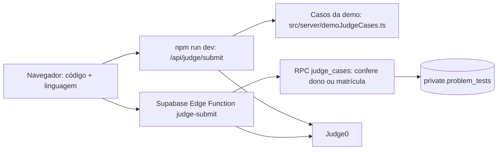

# Judge: execução de código com Judge0

O botão **Executar código** da tela de prática envia a solução do aluno para um servidor, que a roda no Judge0 contra os casos de teste do desafio e devolve o veredito. **Os casos de teste ficam no servidor.** O navegador envia só o código e recebe o veredito, a contagem de casos e, no máximo, a saída do exemplo público.

Histórico: a primeira versão (16/11) foi feita por HerculesDraycon. A Entrega 4 (24/11, fatia 1) moveu os casos para o servidor, tornou o endereço configurável e ligou o modo remoto à Edge Function. O motivo está em [ENTREGA-4.md](ENTREGA-4.md#2-diagnóstico).

## Como funciona



| Peça                     | Arquivo                                               | Papel                                                                                                                      |
| ------------------------ | ----------------------------------------------------- | -------------------------------------------------------------------------------------------------------------------------- |
| Execução no Judge0       | `supabase/functions/_shared/judge0.ts`                | Roda todos os casos, para no primeiro erro, faz polling se o Judge0 enfileirar, nunca devolve a saída de caso oculto       |
| Tratamento da requisição | `supabase/functions/_shared/judgeHandler.ts`          | Valida o corpo, identifica quem chama, busca os casos e responde com códigos claros. É igual no servidor local e na função |
| Servidor local           | `vite.config.ts`                                      | `POST /api/judge/submit` em `npm run dev` e `vite preview`, com os casos de `src/server/demoJudgeCases.ts`                 |
| Edge Function            | `supabase/functions/judge-submit/index.ts`            | Identifica o aluno pelo token da sessão e busca os casos com a RPC `judge_cases` (chave de serviço)                        |
| Casos no banco           | migration `202611240001_judge_tests.sql` e `seed.sql` | `private.problem_tests` por questão; os 31 casos da trilha-base são copiados ao importar a trilha                          |
| Navegador                | `src/lib/judge.ts` e `src/data/index.ts`              | Escolhe o endereço, envia o token da sessão no modo remoto e traduz erros                                                  |

**Quem pode rodar os casos de uma questão** (RPC `judge_cases`): o professor dono da turma, inclusive em rascunho, para validar a solução de referência; e alunos matriculados, só em questões publicadas. Os demais recebem 403. Sem casos cadastrados, vale o exemplo público do enunciado.

**Na demonstração local**, as questões criadas pelo professor existem só no navegador. Por isso os casos delas vão junto com a requisição. O servidor local aceita isso só para questões que não são do catálogo; as do catálogo usam sempre os casos do servidor.

## Contrato HTTP

`POST` com JSON `{ problemId, language: "python" | "java" | "cpp", sourceCode, idempotencyKey? }`. O código-fonte vai até 64 KB.

| Status  | Corpo                                                                                          | Mensagem na tela                                                                |
| ------- | ---------------------------------------------------------------------------------------------- | ------------------------------------------------------------------------------- |
| 200     | `{ id, verdict, passedCases, totalCases, timeMs, memoryKb, stdout?, stderr?, compileOutput? }` | Veredito traduzido                                                              |
| 400     | `invalid_submission_payload`                                                                   | O código enviado é inválido ou grande demais                                    |
| 401     | `authentication_required`                                                                      | Entre novamente                                                                 |
| 403     | `problem_not_accessible`                                                                       | Você não tem acesso aos testes deste desafio                                    |
| 404/405 | (rota inexistente)                                                                             | O serviço de execução não foi encontrado; confira a função e o `VITE_JUDGE_URL` |
| 422     | `no_test_cases`                                                                                | Este desafio ainda não tem casos de teste                                       |
| 502     | `cases_unavailable`                                                                            | O serviço falhou; tente novamente                                               |

## Para onde o navegador envia

| Situação                         | Endereço                                                                   |
| -------------------------------- | -------------------------------------------------------------------------- |
| `VITE_JUDGE_URL=off`             | Nenhum: botão desabilitado com explicação                                  |
| `VITE_JUDGE_URL` preenchido      | Esse endereço                                                              |
| Modo remoto sem `VITE_JUDGE_URL` | `<VITE_SUPABASE_URL>/functions/v1/judge-submit`                            |
| `npm run dev` no modo demo       | `/api/judge/submit`                                                        |
| Build estático (GitHub Pages)    | Nenhum: botão desabilitado. **Era isto que dava 405/404 antes da fatia 1** |

## Publicar no Supabase

Requer a [Supabase CLI](https://supabase.com/docs/guides/cli) ligada ao projeto de desenvolvimento.

1. Aplique as migrations e o `seed.sql` (o seed traz os casos da trilha e preenche turmas já importadas).
2. Configure os segredos do Judge0, nunca em `VITE_*`:
   ```bash
   supabase secrets set JUDGE0_URL=https://ce.judge0.com
   ```
   Com RapidAPI, defina também `JUDGE0_API_KEY`. Com instância própria, `JUDGE0_AUTH_TOKEN`.
3. Publique a função mantendo a verificação de JWT padrão:
   ```bash
   supabase functions deploy judge-submit
   ```
   `SUPABASE_URL`, `SUPABASE_ANON_KEY` e `SUPABASE_SERVICE_ROLE_KEY` são fornecidas pelo Supabase à função.
4. No `.env.local` do site, o modo remoto já aponta para a função. Use `VITE_JUDGE_URL` só para outro endereço.

## Limites conhecidos

- O resultado ainda não é salvo: "Aceito" não conclui o desafio nem chega ao professor. Isso é a fatia 2 ([ENTREGA-4.md](ENTREGA-4.md#5-fatias)).
- Não há limite de frequência por aluno; o Judge0 público (`ce.judge0.com`) tem limites próprios e não garante disponibilidade.
- A Edge Function não foi publicada nem testada num Supabase real neste ambiente. O tratador e o executor têm testes de unidade, e a RPC `judge_cases` tem testes em PostgreSQL.
- Correção sobre a versão anterior: no build publicado, os casos ocultos **não** chegavam ao navegador, porque o minificador os removia. Mas eles moravam num módulo importado pela tela. Agora ficam em `src/server/` e `supabase/functions/_shared/`, e `npm run check` falha se aparecerem no bundle.
